# TerminalWisely

<p align="center">
  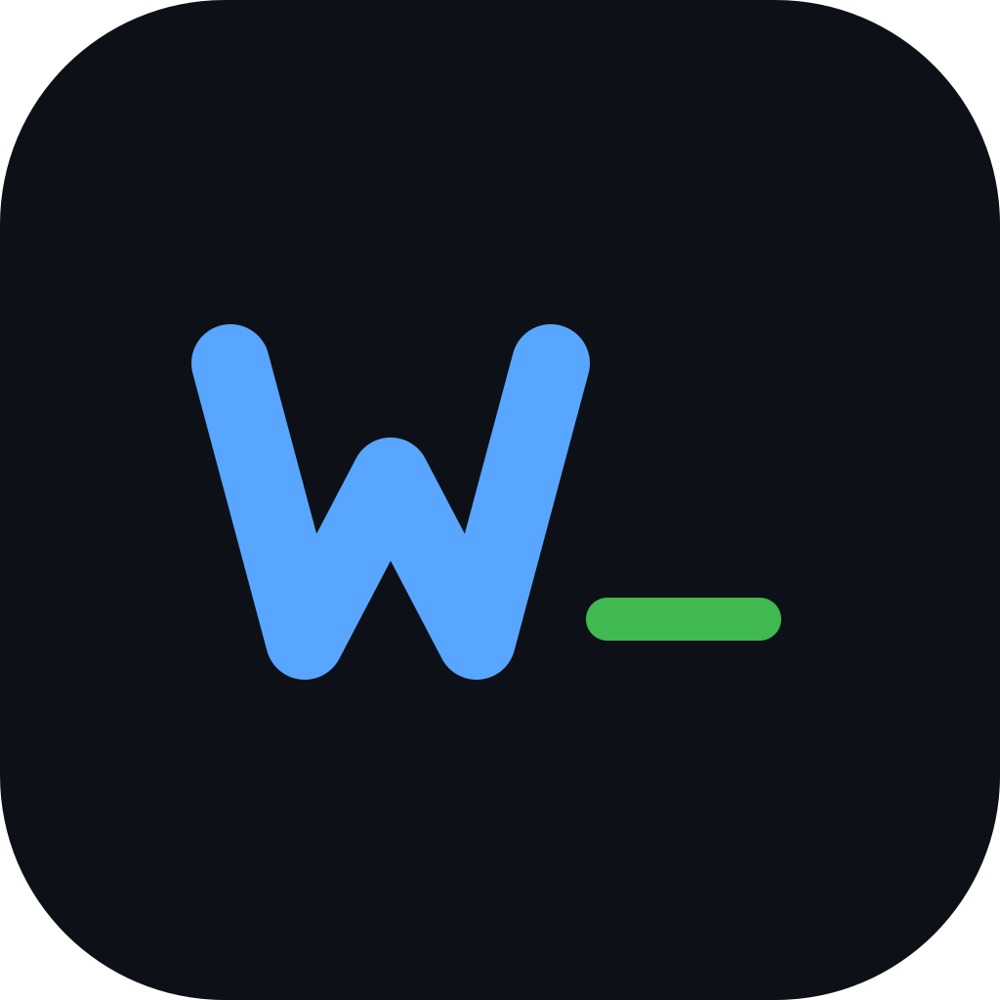
</p>

**English** | [中文](./README.zh-CN.md)

**Current version: [v0.1.0](https://github.com/wiselyman/TerminalWisely/releases/tag/v0.1.0)**

**Local and remote operations in one window.** Home pairs an interactive local Terminal with local chat; Hosts, Kubernetes, and Databases provide remote workspaces with object-specific chats. Changes wait for approval, and STOP is always there.

[Download](https://github.com/wiselyman/TerminalWisely/releases) · [Build from source](./BUILD.md)

<p align="center">
  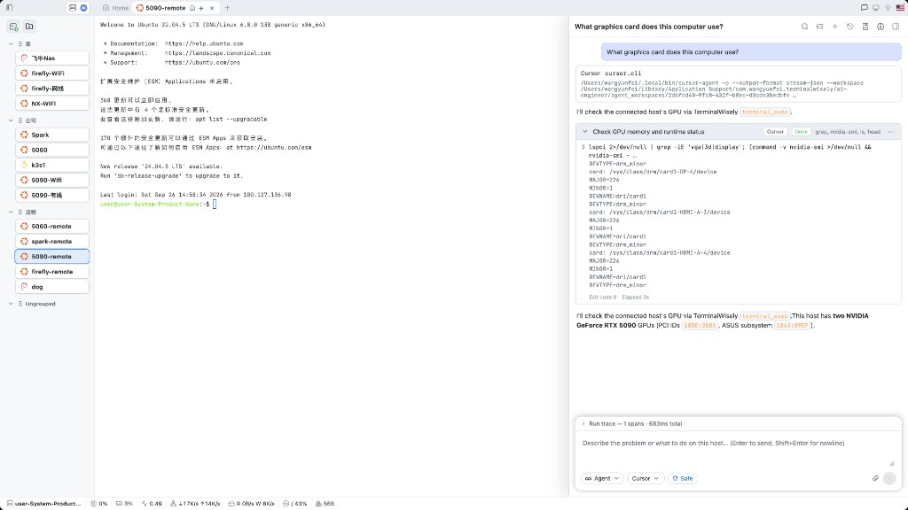
</p>
<p align="center"><em>Figure 1 — A normal AI Engineer chat: ask in plain language; Cursor (or another agent) runs tools on the connected host and answers with evidence.</em></p>

---

## What you get

| Area | Highlights |
|------|------------|
| **Home** | Local interactive Terminal and chat, plus a target-isolated local Desktop with Files, Processes, Browser, Terminal, and MarkWisely. Windows uses PowerShell |
| **Databases** | Direct connections to PostgreSQL, MySQL, MariaDB, SQLite, SQL Server, Oracle, MongoDB, and Redis. One service, one tab, one chat. Table tabs show database and schema. Connections can be grouped |
| **Agent runtimes** | Cursor Agent, Codex, Claude Code on the open host, cluster, or database; dual-plane UX (local CLI stream + remote exec cards) |
| **Terminal** | Multi-tab SSH, bookmarks, reconnect, English / 中文 UI |
| **Host Desktop** | The workspace becomes the connected host’s desktop. Dock: Files, Processes, Browser (host network), Terminal, AI Linux. Windows stay when you leave and come back |
| **Host Browser** | Open remote HTTP (including `127.0.0.1`) via the existing SSH session; multi-tab, history, bookmarks |
| **Kubernetes** | Sidebar Hosts ↔ K8s; add cluster via + (file or paste kubeconfig) or SSH kubectl; resource tree, YAML, logs, Pod shell. One-click install of kubectl/Helm into the app data dir (or use PATH / SSH). Practical Lens-inspired subset — not a full Lens IDE |
| **Files** | Drag-and-drop upload, click `ls` paths to `cd` or preview; Markdown Typora-like WYSIWYG; download, compress, cross-server send |
| **AI Engineer** | Local chat in Home; follows the open host, cluster, or database elsewhere. Long runs keep the SSH lease; the same chat stays continuous when you switch models or agents |
| **Models** | OpenAI-compatible APIs, Ollama, Anthropic-compatible gateways, Gemini |
| **Safety** | Policy-graded commands (read / mutate / deny); approval cards; stop anytime |
| **Insight** | Host CPU, memory, disk I/O, and network on the status bar |

---

## Home Desktop

In Home, use the Desktop control to switch from the local Terminal and chat to the local Desktop. Files, Processes, Browser, Terminal, AI Local, and MarkWisely operate on this computer. AI Local opens the existing Home chat in a Desktop window and keeps its transcript and draft; it does not create an SSH session. AI Linux remains available only in SSH Host Desktop. The Desktop Terminal moves the active Home terminal into its window and returns it without starting another shell. Local Desktop windows, browser tabs, and recent Markdown files have their own state, separate from each SSH host.

Windows Home Terminal remains Windows PowerShell 5.1. Windows packages include Microsoft Coreutils for Windows v2026.9.3 for x64 or ARM64, a preview release. Coreutils commands are available by command name in the app terminal; PowerShell 5.1 does not receive the full PowerShell 7 globbing and pipeline integration. The app adds its bundled command directory and clears conflicting aliases only in that terminal process. It does not change the system PATH, PowerShell profiles, or registry.

---

## Models & agents

Switch between **Model** (built-in profiles you configure) and **Agent** (local CLIs) from the picker under the composer.

<p align="center">
  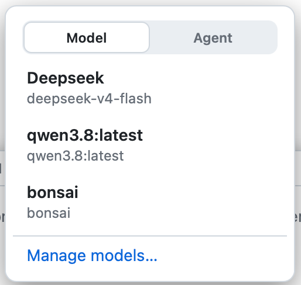
</p>
<p align="center"><em>Figure 2 — Model selection: pick a configured profile (OpenAI-compatible, Ollama, …) or open Manage models…</em></p>

<p align="center">
  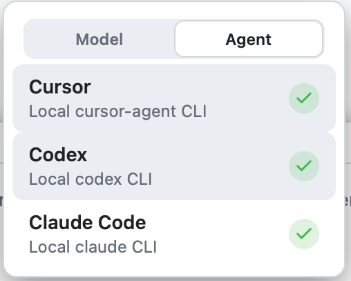
</p>
<p align="center"><em>Figure 3 — Agent selection: Cursor, Codex, and Claude Code when the local CLI is installed and ready.</em></p>

### Cursor / Codex / Claude Code as ops agents

Open **AI Engineer** → pick a runtime (**Built-in**, **Cursor**, **Codex**, or **Claude Code**).

- **Their agent, your session** — the CLI runs locally; remote work goes through TW’s MCP (`terminal_exec`, `k8s_*`, …) on the session you already own.
- **No shadow SSH** — same lease as the terminal tab; long runs keep it alive.
- **Approvals stay in TW** — capability grades (R0–R4); mutations need exact target-bound approval; agent source is labeled on the card.
- **Install & login guidance** — missing CLI or expired auth surfaces as a guided flow, not a silent background install.

Requires the corresponding CLI installed and signed in on your machine (Cursor Agent / Codex / Claude Code).

### Built-in AI Linux & K8S Engineers

Mode follows the sidebar:

- **Hosts** → **AI Linux Engineer** on the connected SSH session (`terminal_exec`)
- **K8s** → **AI K8S Engineer** on the selected cluster (`k8s_list` / `k8s_get` / `k8s_logs` / …)
- **Databases** → SQL on that service (`db_search_objects` / `db_query` / `db_explain`)

- **Same session / cluster** — no hidden second SSH login; kubectl jumps use the bound session.
- **Evidence first** — the agent reads output before concluding.
- **You stay in control** — read-only probes can run on their own; writes need your explicit approval.
- **Bring your model** — save multiple profiles (cloud or local) and switch the active one in Settings.

### Example asks

| You say | What happens |
|---------|----------------|
| “Find what’s eating disk” | `df` / `du` drill-down (Linux) |
| “Who listens on 8080?” | Socket / process lookup; kill only after approval |
| “Why is this Pod CrashLooping?” | `k8s_describe` / `k8s_logs` on the selected cluster |
| “Scale api to 3” | `k8s_scale` after approval |
| “nginx 502” | Status, logs, upstream checks |
| “How much GPU memory?” | Read-only checks such as `nvidia-smi` |
| “Which tables mention orders?” | Search objects on the open database, then query |

---

## Host Desktop

Click the host icon. Sidebar, title bar, and status bar stay. Everything to the right becomes that connected Linux host’s desktop. Click the icon again and the terminal returns. Open windows and their positions are still there when you come back.

<p align="center">
  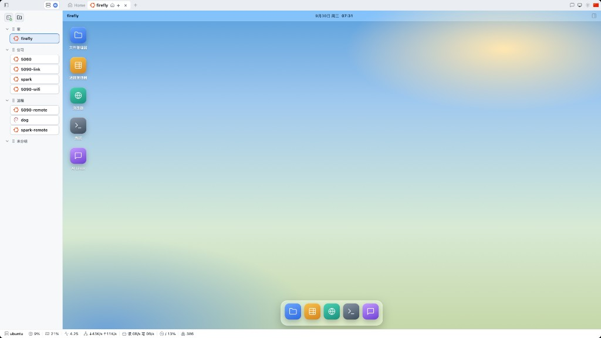
</p>
<p align="center"><em>Figure 4 — Host desktop: wallpaper, app icons, and a dock on the connected machine.</em></p>

<p align="center">
  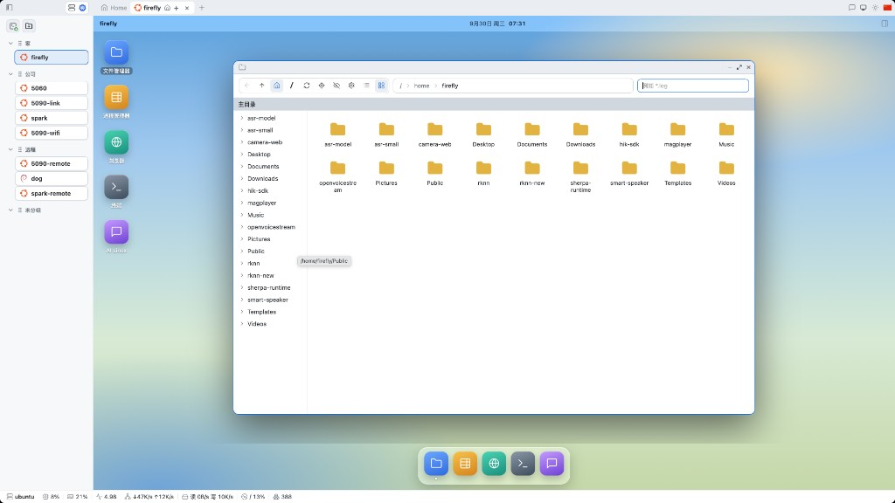
</p>
<p align="center"><em>Figure 5 — Files: browse the remote filesystem.</em></p>

<p align="center">
  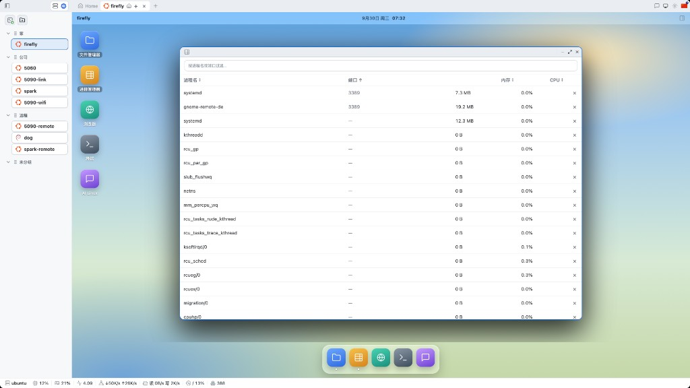
</p>
<p align="center"><em>Figure 6 — Processes: name, ports, memory, and CPU on the host.</em></p>

<p align="center">
  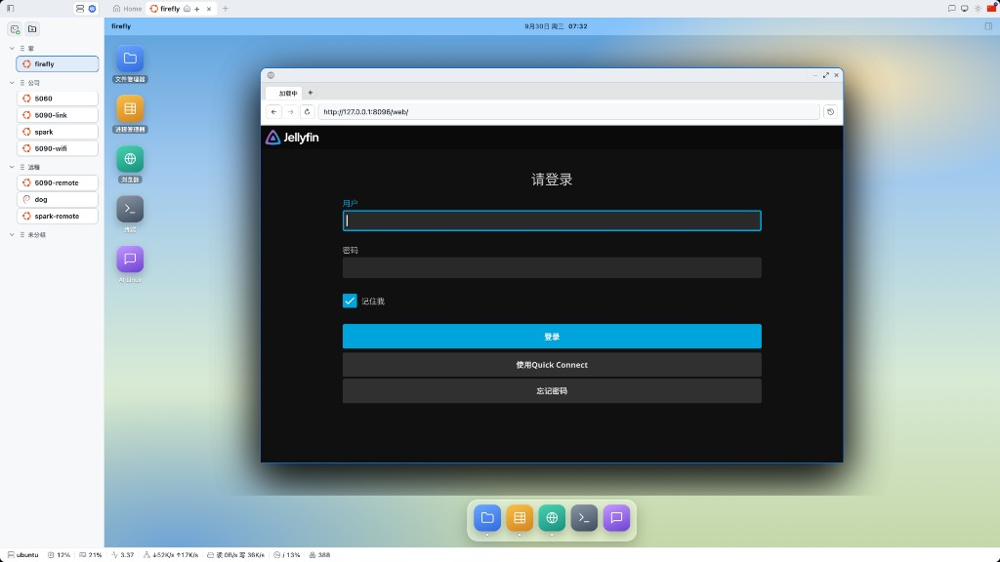
</p>
<p align="center"><em>Figure 7 — Browser uses the <strong>host’s network</strong> (including <code>127.0.0.1</code>) through the existing SSH session.</em></p>

<p align="center">
  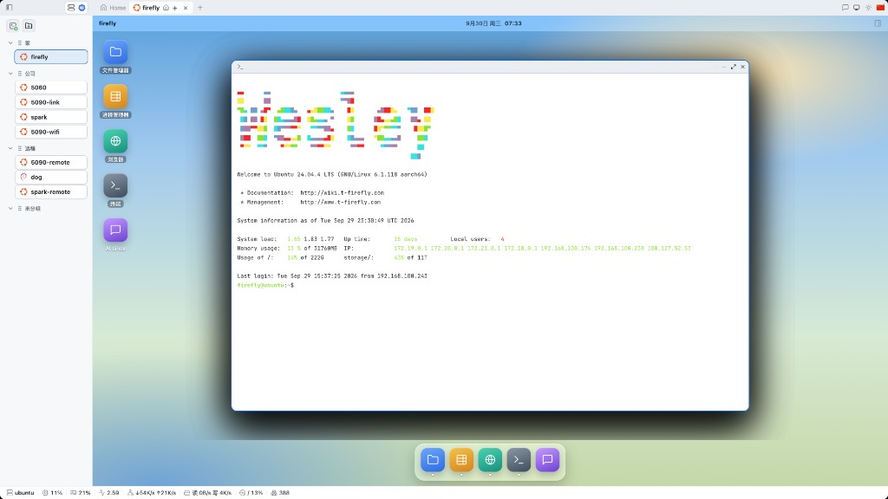
</p>
<p align="center"><em>Figure 8 — Terminal is the same SSH session, inside a desktop window.</em></p>

<p align="center">
  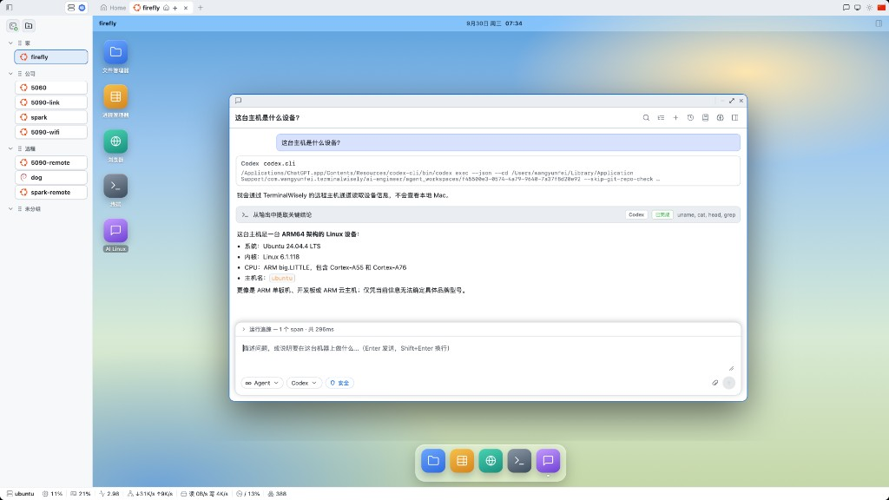
</p>
<p align="center"><em>Figure 9 — AI Linux is the same AI Engineer chat, filling the desktop window.</em></p>

<p align="center">
  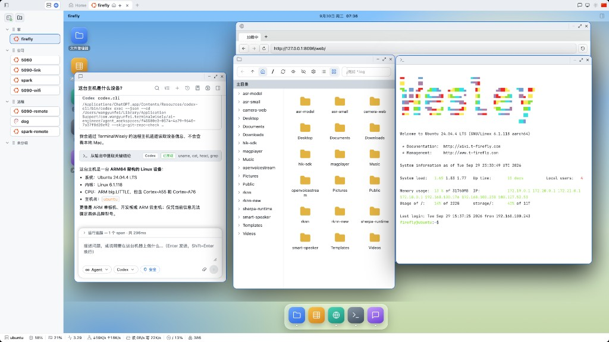
</p>
<p align="center"><em>Figure 10 — Several apps open at once. Drag and resize; the front window stays on top.</em></p>

<p align="center">
  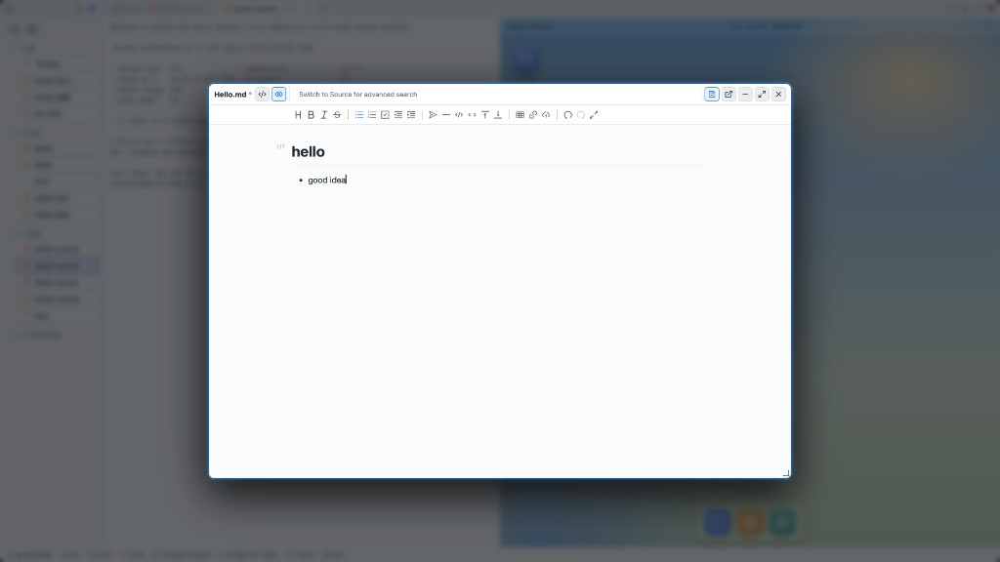
</p>
<p align="center"><em>Figure 11 — Markdown WYSIWYG editing (Typora-like) on the remote host.</em></p>

<p align="center">
  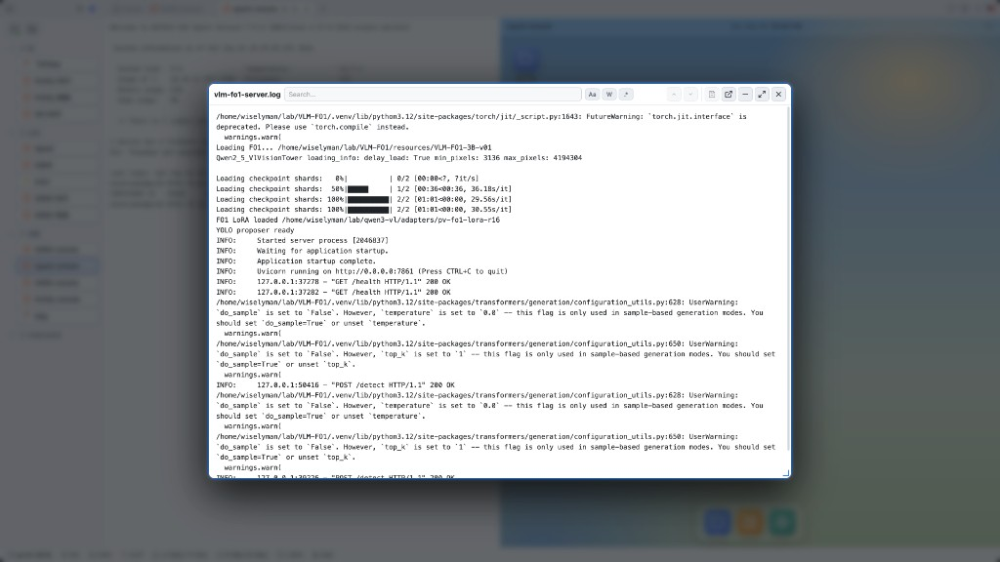
</p>
<p align="center"><em>Figure 12 — Preview and search common files such as logs on the remote host.</em></p>

<p align="center">
  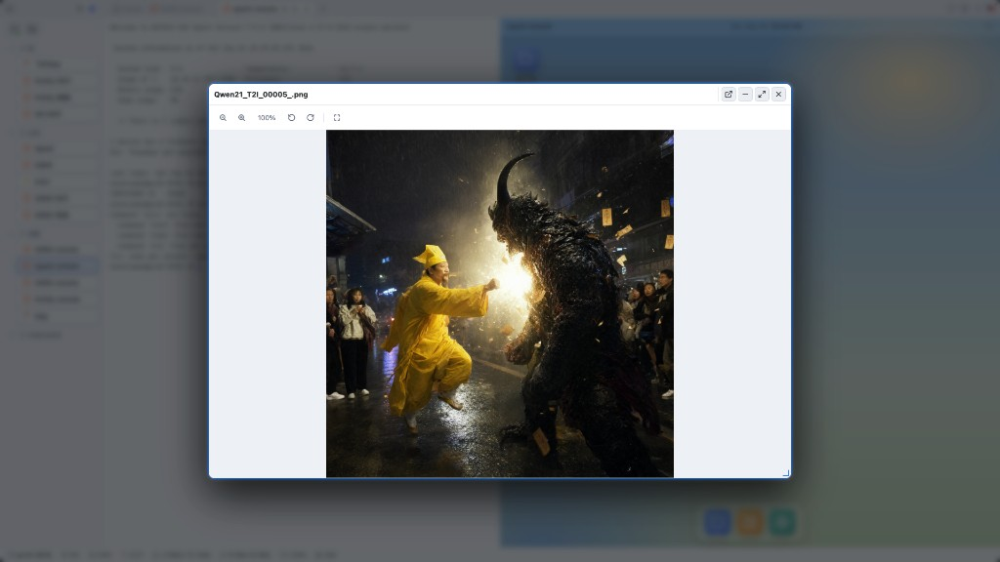
</p>
<p align="center"><em>Figure 13 — Image and other mainstream file types open in the preview panel.</em></p>

### Terminal & transfers

- **Upload** — drop files onto the terminal or tab → SFTP to the current directory  
- **Navigate** — click directory names in `ls` output  
- **Preview & edit** — click file paths; Markdown is Typora-like WYSIWYG; syntax highlight and search for text  
- **Download** — Ctrl/Cmd + click a path, or use the context menu  
- **Send elsewhere** — right-click a path, or drag to another SSH tab  
- **Command Nav** — 90+ ops snippets inserted into the shell (never auto-run)

---

## Kubernetes workbench

Switch the sidebar to **Kubernetes**: overview, workloads, network, storage, and security resources — plus AI on the selected cluster.

<p align="center">
  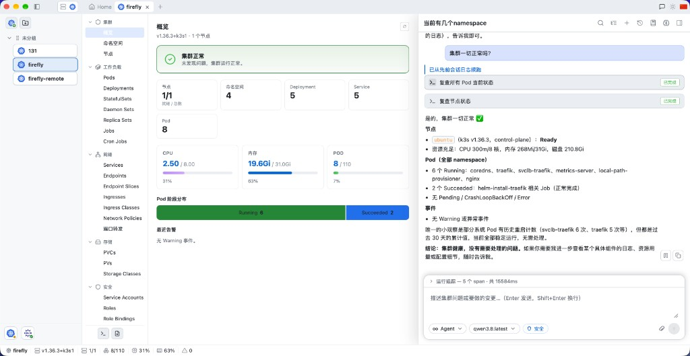
</p>
<p align="center"><em>Figure 14 — Kubernetes ops: cluster overview and AI Engineer answering whether the cluster is healthy.</em></p>

---

## Databases

Switch the sidebar to **Databases** and add a connection. The workbench opens a service tab as soon as the connection lists its databases. A second connection keeps the first service, its inner tabs, and its chat.

<p align="center">
  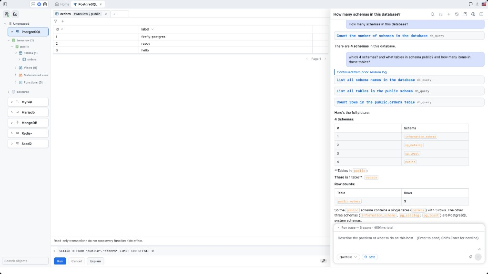
</p>
<p align="center"><em>Figure 15 — Database workbench: the PostgreSQL service, the orders table labeled <code>twreview / public</code>, and that service’s own AI chat.</em></p>

- **One service, one chat** — PostgreSQL and MySQL do not share a conversation.
- **Table tabs** show the database and schema on one line, for example `shop / public`.
- **Groups** — connections start under 未分组 / Ungrouped. Add your own groups; host groups are not copied here.
- **SQL** — run a statement on the table tab. A restore icon appears after you run something other than the default browse, and puts the table’s data back. Typing in the editor does not change the grid until you run.
- **AI** follows this service. Read-only SQL can run; changes wait for approval.

---

## Quick start

1. **Hosts** — add an SSH host and connect, or click the host icon to open that machine’s desktop.
2. **Kubernetes** — switch the sidebar and click **+** to add a cluster (kubeconfig file or paste).
3. **Databases** — switch the sidebar and add a connection.
4. Optional: open **AI Engineer** → choose a runtime (Built-in model, or Cursor / Codex / Claude Code if installed). Home provides a local chat beside the local Terminal.
5. For Built-in: Settings → add a model profile (Base URL + model id; Ollama often needs no key).
6. Approve or reject any command the agent marks as a system change.

Kubernetes notes: local cluster ops prefer kubectl/Helm installed into the app data directory (one-click from the UI), with PATH as fallback; SSH jump hosts still use the remote PATH. The K8s UI is a practical Lens-inspired subset — not a full Lens IDE.

---

## Download

Installers for **Windows**, **macOS** (Apple Silicon & Intel), and **Linux** (deb, rpm, AppImage; x86_64 & ARM64) are on the [Releases](https://github.com/wiselyman/TerminalWisely/releases) page.

The AI runtime ships inside the app. The first time you open AI Engineer, dependencies install automatically in the background (progress is shown in the UI).

### macOS

If macOS says **“TerminalWisely” is damaged and can’t be opened** and asks you to move it to the Trash, the app is not damaged. Gatekeeper quarantined the download. Copy it to `/Applications`, then run:

```bash
xattr -cr /Applications/TerminalWisely.app
```

Open TerminalWisely again.

---

## License

[MIT](./LICENSE)
