# TerminalWisely

<p align="center">
  
</p>

**English** | [中文](./README.zh-CN.md)

**Current version: 0.1.3** · **Latest release: [Download the latest version](https://github.com/wiselyman/TerminalWisely/releases/latest)**

**Local and remote desktops in one window.** The Home icon opens saved SSH hosts in their groups, while Local Desktop stays pinned as the first workspace tab. Select a host to open its Desktop workspace. Terminal and chat run as apps inside their Desktop. Changes wait for approval, and STOP is always there.

[Download](https://github.com/wiselyman/TerminalWisely/releases) · [Build from source](./BUILD.md)

<p align="center">
  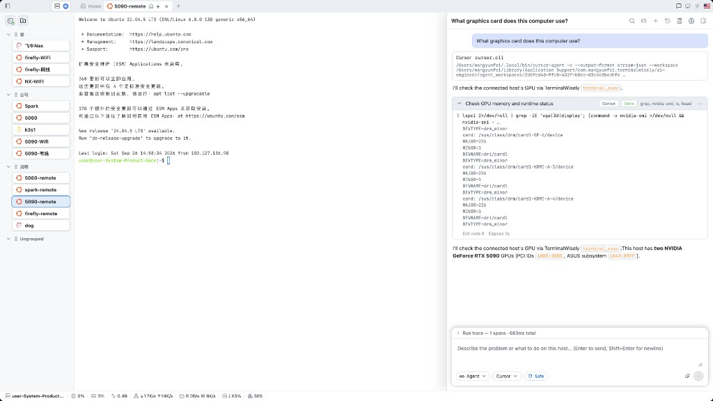
</p>
<p align="center"><em>Figure 1 — A normal AI Engineer chat: ask in plain language; Cursor (or another agent) runs tools on the connected host and answers with evidence.</em></p>

---

## What you get

| Area | Highlights |
|------|------------|
| **Home** | An icon launcher for the grouped host directory; Local Desktop is the first pinned workspace tab and contains Terminal, AI Local, MarkWisely, and EditorWisely. Files, browser, and process management remain native tools on your computer. Windows uses PowerShell |
| **Agent runtimes** | Cursor Agent, Codex, Claude Code on the current local or SSH host; dual-plane UX (local CLI stream + remote exec cards) |
| **Terminal** | Local and remote Terminal apps inside Desktop workspaces, saved SSH hosts, reconnect, English / 中文 UI |
| **Host Desktop** | The workspace becomes the connected host’s desktop. Dock: Files, Processes, Browser (host network), Terminal, AI Linux. Windows stay when you leave and come back |
| **Host Browser** | Open remote HTTP (including `127.0.0.1`) via the existing SSH session; multi-tab, history, bookmarks |
| **Files** | Drag-and-drop upload, click `ls` paths to `cd` or preview; MarkWisely local/remote Markdown workspace with document tabs, file navigation, and outline; EditorWisely source and text editor; download, compress, cross-server send |
| **AI Engineer** | Local chat in Home; follows the active SSH host elsewhere. Long runs keep the SSH lease; the same chat stays continuous when you switch models or agents |
| **Models** | OpenAI-compatible APIs, Ollama, Anthropic-compatible gateways, Gemini |
| **Safety** | Policy-graded commands (read / mutate / deny); approval cards; stop anytime |
| **Insight** | Host CPU, memory, disk I/O, and network on the status bar |

---

## Home Desktop

The Home icon at the left of the titlebar opens the saved host directory. The directory shows saved SSH hosts in their existing groups and has no Local entry. Local Desktop is a single fixed workspace tab immediately after the Home icon and before SSH tabs; selecting it does not create an SSH session. All workspace tabs represent Desktop workspaces; the left Hosts list and standalone Terminal tabs are removed. The Local Desktop Dock contains Terminal, AI Local, MarkWisely, and EditorWisely. Files, browser, and process management are already available as native tools on this computer, so they are not duplicated in the Home Dock. AI Local opens the existing local chat in a Desktop window and keeps its transcript and draft; it does not create an SSH session. AI Linux remains available only in SSH Host Desktop. The Desktop Terminal uses the existing local PTY without creating a standalone tab. Local Desktop windows and recent Markdown files have their own state, separate from each SSH host.

The Local Desktop Terminal on Windows uses Windows PowerShell 5.1. Windows packages include Microsoft Coreutils for Windows v2026.9.3 for x64 or ARM64, a preview release. Coreutils commands are available by command name in the app terminal; PowerShell 5.1 does not receive the full PowerShell 7 globbing and pipeline integration. The app adds its bundled command directory and clears conflicting aliases only in that terminal process. It does not change the system PATH, PowerShell profiles, or registry.

---

## EditorWisely

EditorWisely is the text and source editor included in both the Home and SSH Host Desktops. Browse local or remote files in its directory tree and keep multiple documents open in tabs. Open local plain-text files with EditorWisely from the operating system to show the file in a workspace that fills the TerminalWisely window. Local documents use Home’s filesystem; remote documents use the already connected SSH session.

- **Syntax highlighting** — JavaScript/TypeScript, Python, Go, Rust, Shell, C/C++, Java, PHP, JSON, YAML, TOML, XML, HTML, CSS/Sass, SQL, Markdown, Kotlin, Swift, Ruby, properties, Dockerfiles, and Makefiles.
- **Editing tools** — multiple document tabs, line numbers, find and replace, undo and redo, indentation, and a status bar with language, cursor position, encoding, and line endings.
- **Save with confidence** — writable files save automatically after typing pauses, and you can also save explicitly. Unsaved changes are marked; closing a modified document asks before discarding it. Failed reads or writes keep the edited text available.
- **Preserve text format** — UTF-8 files, UTF-8 BOM, and LF/CRLF line endings are retained when saving. Binary files and unsupported encodings are reported instead of silently rewritten.

EditorWisely and MarkWisely are separate Desktop apps: EditorWisely handles plain text and source files, while MarkWisely remains the Markdown writing workspace.

## MarkWisely

MarkWisely opens Markdown documents from local or SSH-host Files in a workspace that fills its TerminalWisely window. Opening a local Markdown file with TerminalWisely now opens that document directly in MarkWisely instead of showing only its home screen. Keep several documents open in titlebar tabs, browse Markdown files from the left tree, and open the document outline on the right to jump between headings. Closing a document tab leaves the workspace open; the window close button closes the MarkWisely workspace.

---

## Models & agents

Switch between **Model** (built-in profiles you configure) and **Agent** (local CLIs) from the picker under the composer.

<p align="center">
  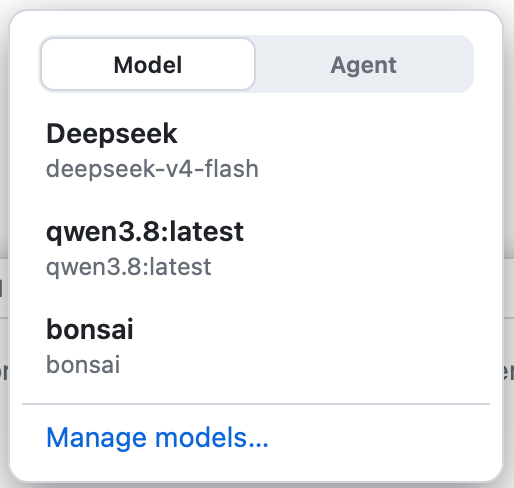
</p>
<p align="center"><em>Figure 2 — Model selection: pick a configured profile (OpenAI-compatible, Ollama, …) or open Manage models…</em></p>

<p align="center">
  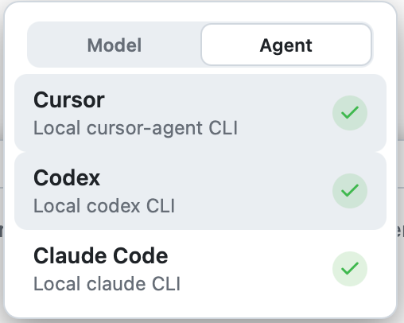
</p>
<p align="center"><em>Figure 3 — Agent selection: Cursor, Codex, and Claude Code when the local CLI is installed and ready.</em></p>

### Cursor / Codex / Claude Code as ops agents

Open **AI Engineer** → pick a runtime (**Built-in**, **Cursor**, **Codex**, or **Claude Code**).

- **Their agent, your session** — the CLI runs locally; remote work goes through TW’s MCP (`terminal_exec`, web tools, …) on the session you already own.
- **No shadow SSH** — same lease as the terminal tab; long runs keep it alive.
- **Approvals stay in TW** — capability grades (R0–R4); mutations need exact target-bound approval; agent source is labeled on the card.
- **Install & login guidance** — missing CLI or expired auth surfaces as a guided flow, not a silent background install.

Requires the corresponding CLI installed and signed in on your machine (Cursor Agent / Codex / Claude Code).

### Built-in AI for local and SSH sessions

- **Home** → local AI chat with the local Terminal
- **Hosts** → AI on the connected SSH session (`terminal_exec`)
- **Same session** — no hidden second SSH login.
- **Evidence first** — the agent reads output before concluding.
- **You stay in control** — read-only probes can run on their own; writes need your explicit approval.
- **Bring your model** — save multiple profiles (cloud or local) and switch the active one in Settings.

### Example asks

| You say | What happens |
|---------|----------------|
| “Find what’s eating disk” | `df` / `du` drill-down (Linux) |
| “Who listens on 8080?” | Socket / process lookup; kill only after approval |
| “nginx 502” | Status, logs, upstream checks |
| “How much GPU memory?” | Read-only checks such as `nvidia-smi` |

---

## Host Desktop

Click the host icon. Sidebar, title bar, and status bar stay. Everything to the right becomes that connected Linux host’s desktop. Click the icon again and the terminal returns. Open windows and their positions are still there when you come back.

<p align="center">
  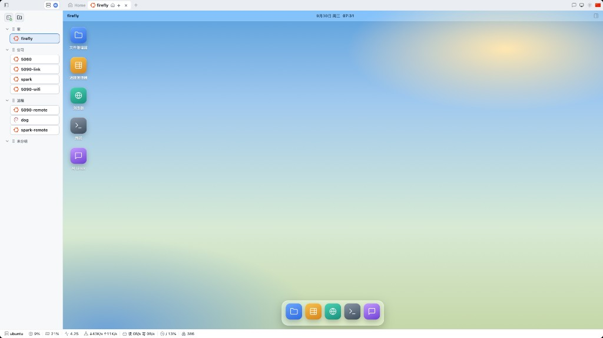
</p>
<p align="center"><em>Figure 4 — Host desktop: wallpaper, app icons, and a dock on the connected machine.</em></p>

<p align="center">
  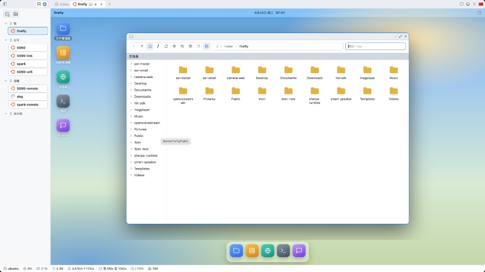
</p>
<p align="center"><em>Figure 5 — Files: browse the remote filesystem.</em></p>

<p align="center">
  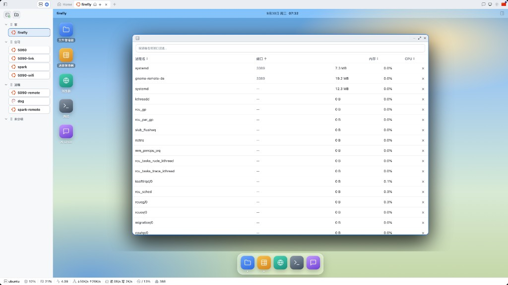
</p>
<p align="center"><em>Figure 6 — Processes: name, ports, memory, and CPU on the host.</em></p>

<p align="center">
  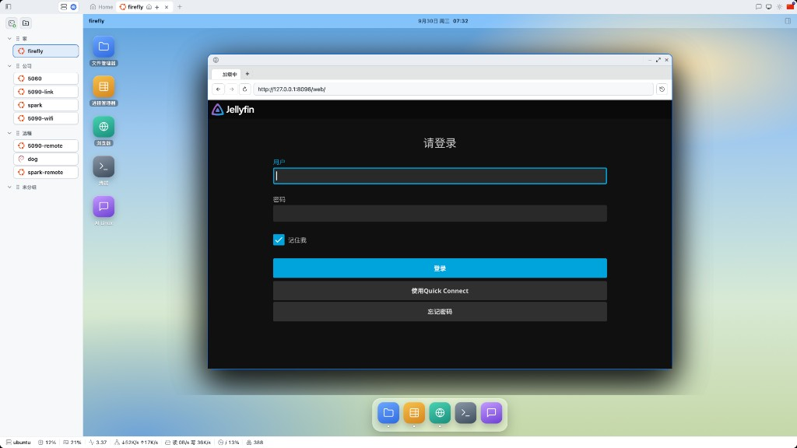
</p>
<p align="center"><em>Figure 7 — Browser uses the <strong>host’s network</strong> (including <code>127.0.0.1</code>) through the existing SSH session.</em></p>

<p align="center">
  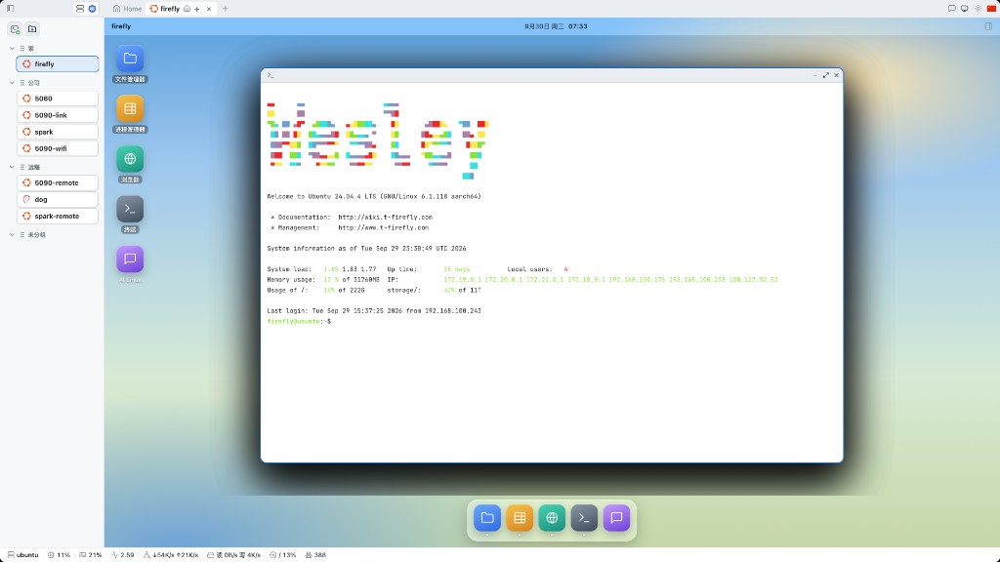
</p>
<p align="center"><em>Figure 8 — Terminal is the same SSH session, inside a desktop window.</em></p>

<p align="center">
  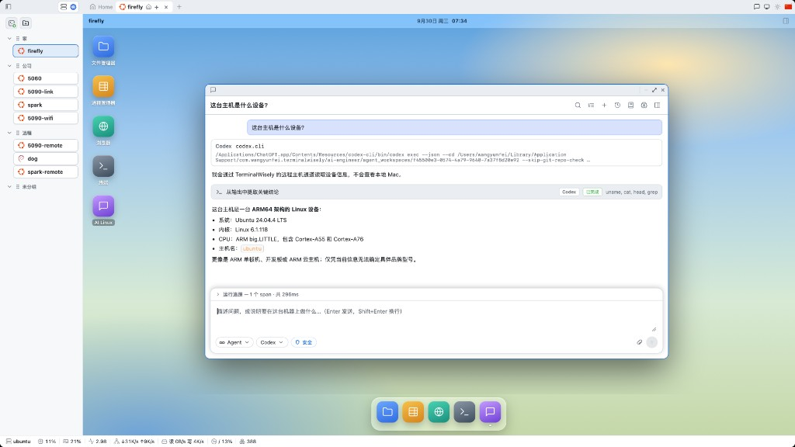
</p>
<p align="center"><em>Figure 9 — AI Linux is the same AI Engineer chat, filling the desktop window.</em></p>

<p align="center">
  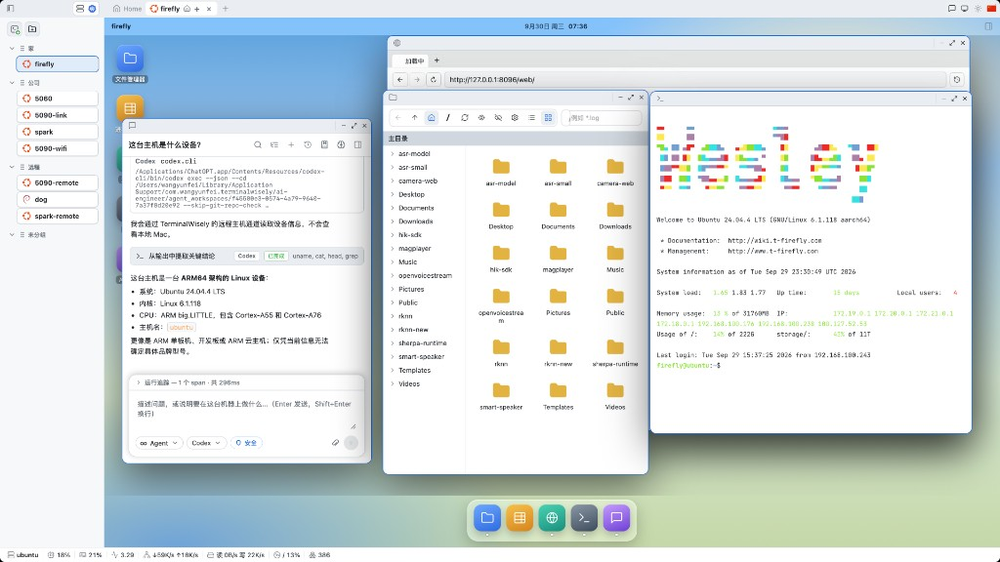
</p>
<p align="center"><em>Figure 10 — Several apps open at once. Drag and resize; the front window stays on top.</em></p>

<p align="center">
  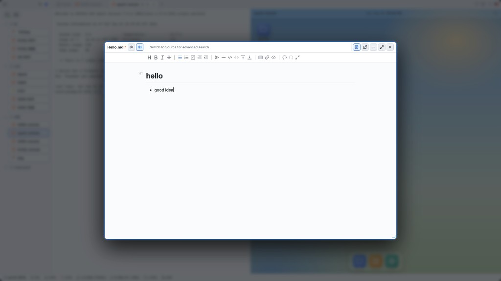
</p>
<p align="center"><em>Figure 11 — Markdown WYSIWYG editing (Typora-like) on the remote host.</em></p>

<p align="center">
  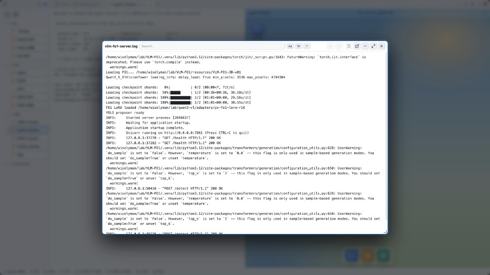
</p>
<p align="center"><em>Figure 12 — Preview and search common files such as logs on the remote host.</em></p>

<p align="center">
  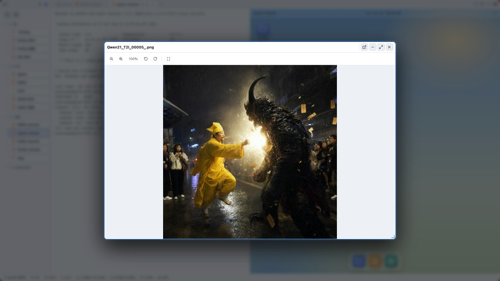
</p>
<p align="center"><em>Figure 13 — Image and other mainstream file types open in the preview panel.</em></p>

### Terminal & transfers

- **Upload** — drop files onto the terminal or tab → SFTP to the current directory  
- **Navigate** — click directory names in `ls` output  
- **Preview & edit** — click file paths; Markdown is Typora-like WYSIWYG; syntax highlight and search for text  
- **Download** — Ctrl/Cmd + click a path, or use the context menu  
- **Send elsewhere** — right-click a path, or drag to another SSH tab  
- **Command Nav** — 90+ ops snippets inserted into the shell (never auto-run)

---

## Quick start

1. **Hosts** — add an SSH host and connect, or click the host icon to open that machine’s desktop.
2. Optional: open **AI Engineer** → choose a runtime (Built-in model, or Cursor / Codex / Claude Code if installed). Home provides a local chat beside the local Terminal.
3. For Built-in: Settings → add a model profile (Base URL + model id; Ollama often needs no key).
4. Approve or reject any command the agent marks as a system change.


---

## Download

Installers for **Windows**, **macOS** (Apple Silicon & Intel), and **Linux** (deb, rpm, AppImage; x86_64 & ARM64) are on the [Releases](https://github.com/wiselyman/TerminalWisely/releases) page.

The AI runtime ships inside the app. The first time you open AI Engineer, dependencies install automatically in the background (progress is shown in the UI).

### macOS

If macOS says **“TerminalWisely” is damaged and can’t be opened** and asks you to move it to the Trash, the app is not damaged. Gatekeeper quarantined the download. Copy it to `/Applications`, then run:

```bash
xattr -cr /Applications/TerminalWisely.app
```

Open TerminalWisely again.

---

## License

[MIT](./LICENSE)
