# TerminalWisely

<p align="center">
  
</p>

[English](./README.md) | **中文**

**当前版本：0.1.3** · **最新版本：[下载最新版本](https://github.com/wiselyman/TerminalWisely/releases/latest)**

**本机与远程 Desktop，在同一个窗口。** Home 先显示本机，再按分组列出已保存 SSH 主机；选择主机即可打开对应 Desktop。Terminal 和聊天作为 Desktop 内的应用运行。变更要批准，随时可以 STOP。

[下载安装包](https://github.com/wiselyman/TerminalWisely/releases) · [自行构建](./BUILD.md)

<p align="center">
  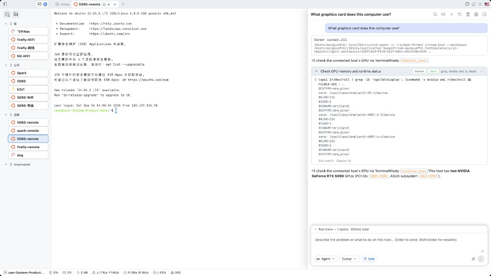
</p>
<p align="center"><em>图 1 — 常规 AI 工程师对话：自然语言提问；Cursor（或其他 Agent）在已连接主机上执行工具，并基于证据回答。</em></p>

---

## 能做什么

| 模块 | 能力 |
|------|------|
| **Home** | 分组主机目录和状态隔离的本机 Desktop：Terminal、AI Local、MarkWisely 和 EditorWisely。文件、浏览器与进程管理使用电脑自带的应用；Windows 使用 PowerShell |
| **Agent 运行时** | Cursor Agent / Codex / Claude Code 跟随当前本机或 SSH 主机；双平面 UX（本机 CLI 流 + 远端执行卡片） |
| **终端** | Terminal 在本机或远程 Desktop 内运行；保存 SSH 主机、断线重连、中英文界面 |
| **主机 Desktop** | 工作区变成已连接主机的桌面。Dock：文件、进程、浏览器（主机网络）、终端、AI Linux。离开再回来，窗口还在 |
| **主机 Browser** | 经现有 SSH 访问远端 HTTP（含 `127.0.0.1`）；多标签、历史、书签 |
| **文件** | 拖拽上传、`ls` 点击进目录或预览；MarkWisely Markdown 工作台与 EditorWisely 本机/远程文本源码编辑器；下载、压缩、跨服务器发送 |
| **AI 工程师** | Home 使用本机聊天；Hosts 跟随当前 SSH 主机。长任务续租 SSH；同一条对话切换模型或 Agent 后工作连续 |
| **模型** | OpenAI 兼容、Ollama、Anthropic 兼容网关、Gemini |
| **安全** | 命令能力分级（只读 / 变更 / 拒绝）；批准卡片；随时停止 |
| **可观测** | 状态栏显示 CPU、内存、磁盘读写、网络 |

---

## Home 本机 Desktop

Home 打开后显示主机目录，Local 固定在最上方，已保存 SSH 主机沿用现有分组。点击主机卡片会使用现有 SSH 连接流程，并在新标题栏标签打开对应 Desktop；点击 Local 会打开独立的本机 Desktop 标签，不创建 SSH 会话。所有工作区标签都代表 Desktop，左侧 Hosts 列表和独立 Terminal 标签已移除。本机 Desktop Dock 提供 Terminal、AI Local、MarkWisely 和 EditorWisely。文件、浏览器与进程管理本机已有对应应用，因此不在 Home Dock 中重复提供。AI Local 会在桌面窗口中打开现有本机聊天，并保留对话和草稿；不会创建 SSH 会话。AI Linux 仍只在 SSH 主机 Desktop 中提供。Desktop Terminal 使用现有本机 PTY，不创建独立标签。本机桌面的窗口和 Markdown 最近文件都与各 SSH 主机分别保存。

Windows Local Desktop Terminal 继续使用 Windows PowerShell 5.1。Windows 安装包按 x64 或 ARM64 内置微软维护的 Coreutils for Windows v2026.9.3（Preview）。在应用终端里可直接按命令名调用 Coreutils；PowerShell 5.1 不包含完整的 PowerShell 7 通配符和管道集成。应用只在该终端子进程中调整 PATH 并移除冲突别名，不修改系统 PATH、PowerShell Profile 或注册表。

---

## EditorWisely

EditorWisely 是 Home 与 SSH 主机 Desktop 内置的文本和源码编辑器。可从 Desktop Dock 打开，也可在对应文件管理器中选择文本文件并交给 EditorWisely 打开。本机文件使用 Home 文件系统；远程文件沿用当前 SSH 会话。

- **语法高亮** — JavaScript/TypeScript、Python、Go、Rust、Shell、C/C++、Java、PHP、JSON、YAML、TOML、XML、HTML、CSS/Sass、SQL、Markdown、Kotlin、Swift、Ruby、properties、Dockerfile 和 Makefile。
- **编辑工具** — 多文档标签、行号、查找替换、撤销重做、缩进；状态栏显示语言、光标位置、编码和换行格式。
- **可靠保存** — 输入暂停后自动保存，也可手动保存。未保存文档会有标记；关闭修改过的文档前会询问。读写失败时保留编辑内容。
- **保留文本格式** — 保存时保留 UTF-8、UTF-8 BOM 以及 LF/CRLF 换行。二进制文件和不支持的编码会显示错误，不会被静默改写。

EditorWisely 与 MarkWisely 是两个独立的 Desktop 应用：EditorWisely 用于纯文本和源码，MarkWisely 继续作为 Markdown 写作工作台。

---

## 模型与 Agent

在输入框下方的选择器里切换 **Model**（你配置的内置模型 Profile）与 **Agent**（本机 CLI）。

<p align="center">
  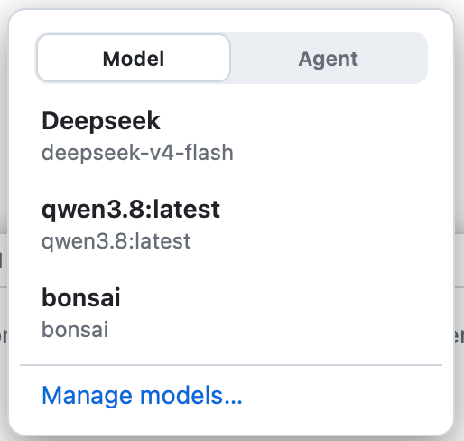
</p>
<p align="center"><em>图 2 — 模型选择：切换已配置的 Profile（OpenAI 兼容、Ollama 等），或进入「管理模型…」。</em></p>

<p align="center">
  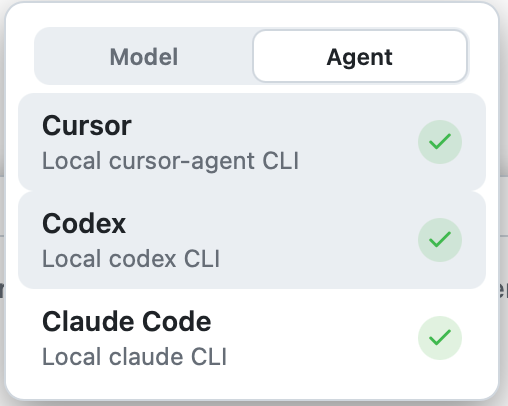
</p>
<p align="center"><em>图 3 — Agent 选择：本机 CLI 就绪时可选 Cursor、Codex、Claude Code。</em></p>

### Cursor / Codex / Claude Code 当作运维 Agent

打开 **AI 工程师** → 选择运行时（**内置**、**Cursor**、**Codex** 或 **Claude Code**）。

- **它们的 Agent，你的会话** — CLI 在本机跑；远端操作经 TW MCP（`terminal_exec` 和 Web 工具）走你已打开的会话。
- **不另开影子 SSH** — 与终端标签同一租约；长任务会续租。
- **审批仍在 TW** — 能力分级（R0–R4）；变更需目标绑定批准；卡片标注 Agent 来源。
- **安装与登录引导** — CLI 缺失或登录过期会进入引导流，不会后台静默安装。

需本机已安装并登录对应 CLI（Cursor Agent / Codex / Claude Code）。

### 本机与 SSH AI

- **Home** → 与本机 Terminal 配套的本机 AI 聊天
- **Hosts** → 使用已连接 SSH 会话的 AI（`terminal_exec`）
- **同一会话** — 不另开静默 SSH 登录。
- **先看证据** — 读取工具输出后再下结论。
- **你说了算** — 只读探测可自动运行；变更需在界面批准。
- **自带模型** — 设置里保存并切换多套云端或本地模型 Profile。

### 可以这样问

| 你说 | 它会 |
|------|------|
| 「磁盘满了，找大目录」 | `df` / `du` 逐层查（Linux） |
| 「8080 谁占着」 | 查监听与进程；结束进程需批准 |
| 「nginx 502」 | 状态、日志、上游检查 |
| 「现在显存多少」 | `nvidia-smi` 等只读命令 |

---

## 主机桌面

点主机图标。侧栏、标题栏、状态栏不动，右边整块变成这台已连接 Linux 主机的桌面。再点一次，回到终端。离开时打开的窗口和位置，回来还在。

<p align="center">
  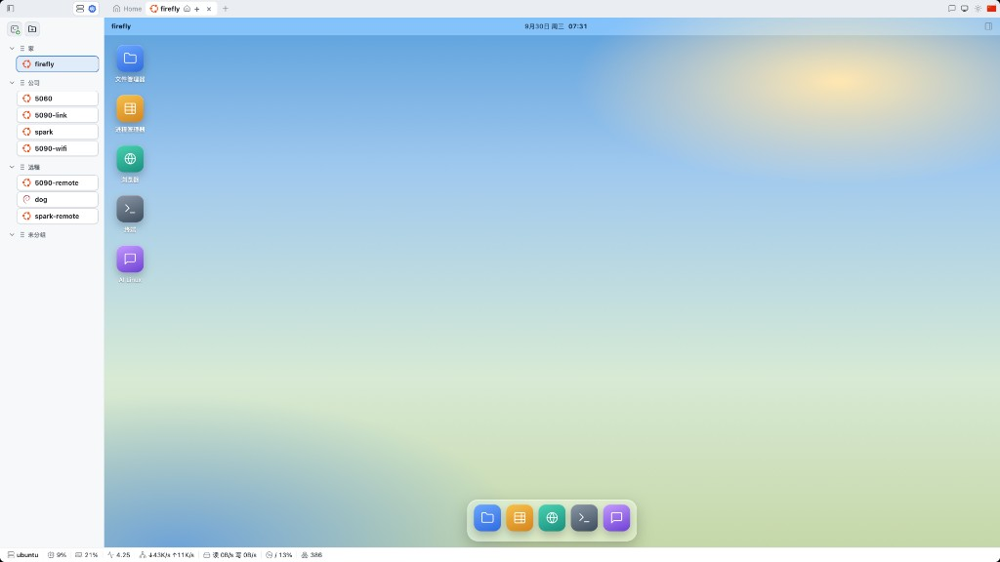
</p>
<p align="center"><em>图 4 — 主机桌面：壁纸、应用图标，以及这台机器上的 Dock。</em></p>

<p align="center">
  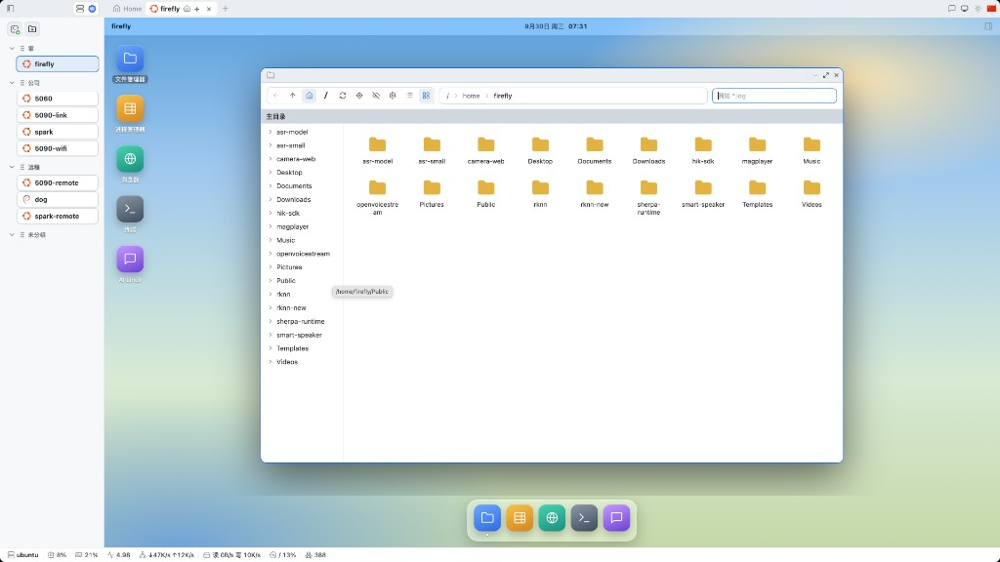
</p>
<p align="center"><em>图 5 — 文件管理器：浏览远端文件系统。</em></p>

<p align="center">
  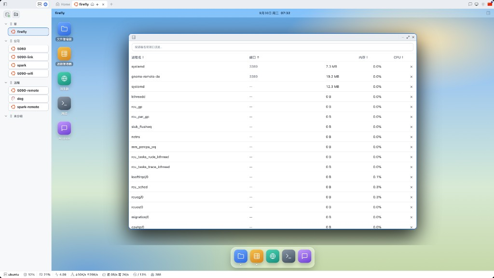
</p>
<p align="center"><em>图 6 — 进程管理器：主机上的进程名、端口、内存与 CPU。</em></p>

<p align="center">
  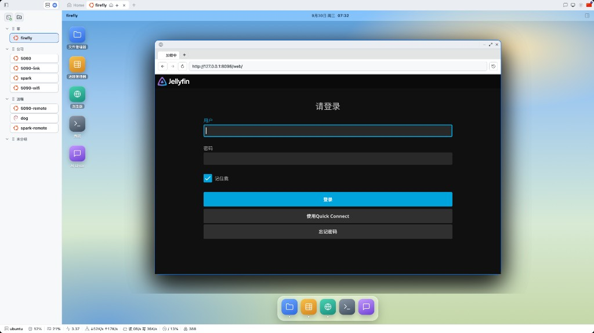
</p>
<p align="center"><em>图 7 — 浏览器用<strong>主机的网络</strong>上网（含 <code>127.0.0.1</code>），走现有 SSH 会话。</em></p>

<p align="center">
  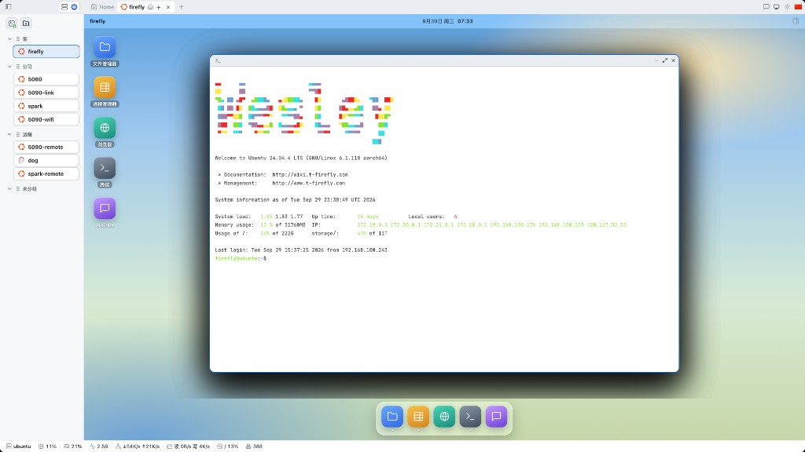
</p>
<p align="center"><em>图 8 — 终端是同一条 SSH 会话，放在桌面窗口里。</em></p>

<p align="center">
  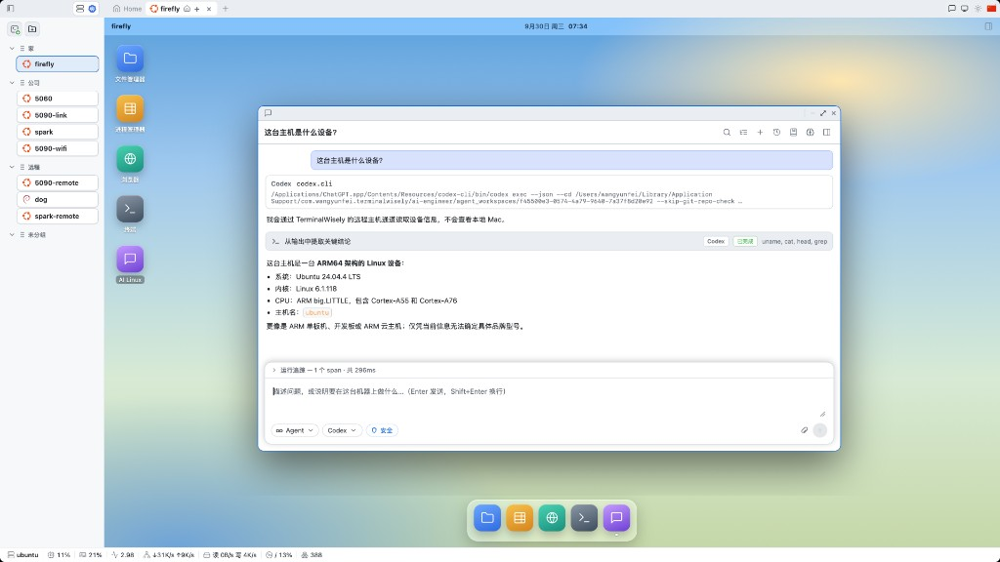
</p>
<p align="center"><em>图 9 — AI Linux 是同一条 AI 工程师对话，铺满桌面窗口。</em></p>

<p align="center">
  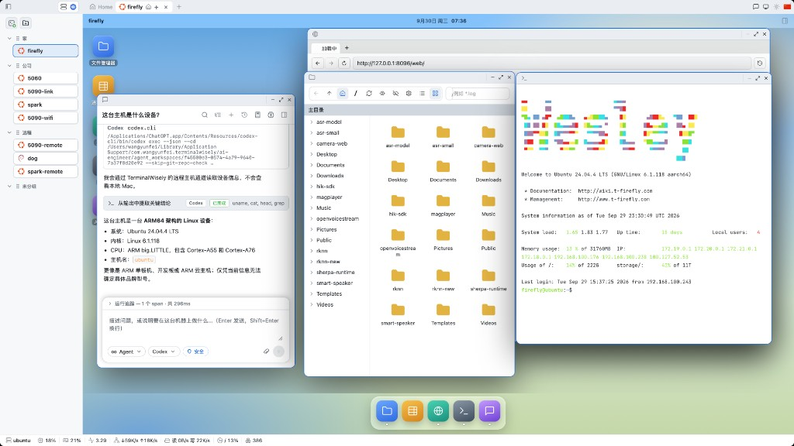
</p>
<p align="center"><em>图 10 — 几个应用同时开着。可以拖动和缩放，最前面的窗口盖在上面。</em></p>

<p align="center">
  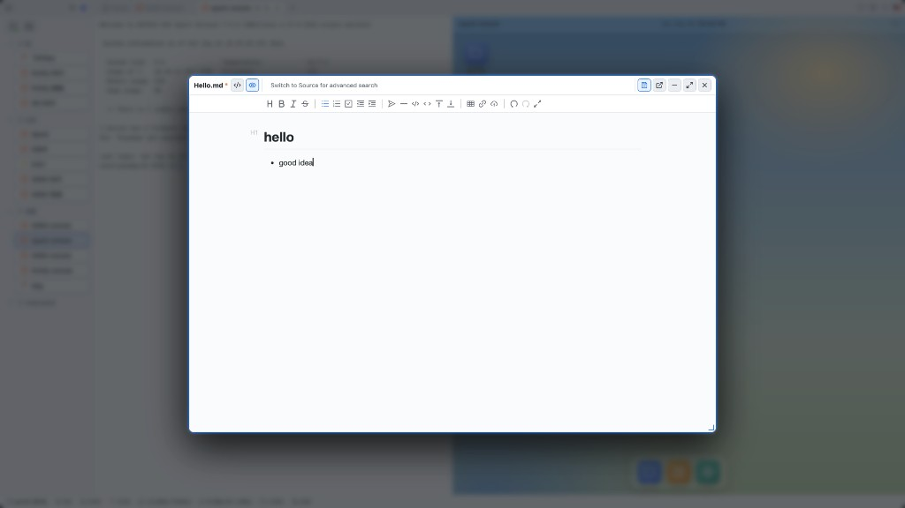
</p>
<p align="center"><em>图 11 — 远端主机上的 Markdown 所见即所得编辑（类 Typora）。</em></p>

<p align="center">
  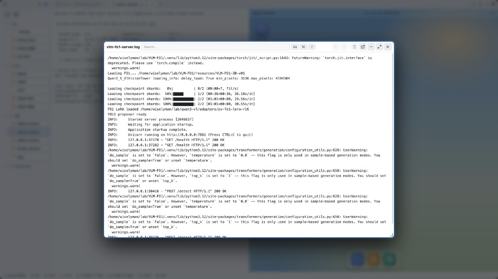
</p>
<p align="center"><em>图 12 — 远端日志等常见文件可预览与搜索。</em></p>

<p align="center">
  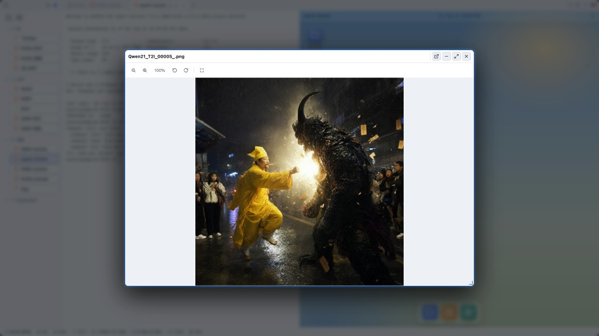
</p>
<p align="center"><em>图 13 — 图片等主流文件类型在预览面板中打开。</em></p>

### 终端与传输

- **上传** — 文件拖到终端或标签 → SFTP 到当前目录  
- **进目录** — 点击 `ls` 里的目录名  
- **预览编辑** — 点击文件路径；Markdown 为类 Typora 所见即所得；文本支持高亮与搜索  
- **下载** — Ctrl/Cmd + 点击路径，或右键菜单  
- **跨服发送** — 右键路径，或拖到另一个 SSH 标签  
- **命令导航** — 90+ 运维命令片段插入终端（不自动执行）

---

## 快速开始

1. **主机** — 添加 SSH 并连接，或点主机图标打开这台机器的桌面。
2. 可选：打开 **AI 工程师** → 选择运行时（内置模型，或已安装的 Cursor / Codex / Claude Code）。Home 的本机聊天位于本机 Terminal 旁边。
3. 内置模式：设置 → 添加模型 Profile（Base URL + 模型名；Ollama 通常免 Key）。
4. 对标记为「系统变更」的命令选择批准或拒绝。


---

## 下载

**Windows**、**macOS**（Apple Silicon / Intel）、**Linux**（deb、rpm、AppImage；x86_64 / ARM64）安装包见 [Releases](https://github.com/wiselyman/TerminalWisely/releases)。

AI 运行时已打包在应用内。首次打开 AI 工程师时，会在后台自动完成依赖安装（界面有进度提示）。

### macOS

若打开时提示：

> 「TerminalWisely」已损坏，无法打开。你应该将它移到废纸篓。

应用本身没有损坏，是系统给下载文件加了隔离属性。拖进「应用程序」后，在终端执行：

```bash
xattr -cr /Applications/TerminalWisely.app
```

再打开即可。

---

## 许可证

[MIT](./LICENSE)
