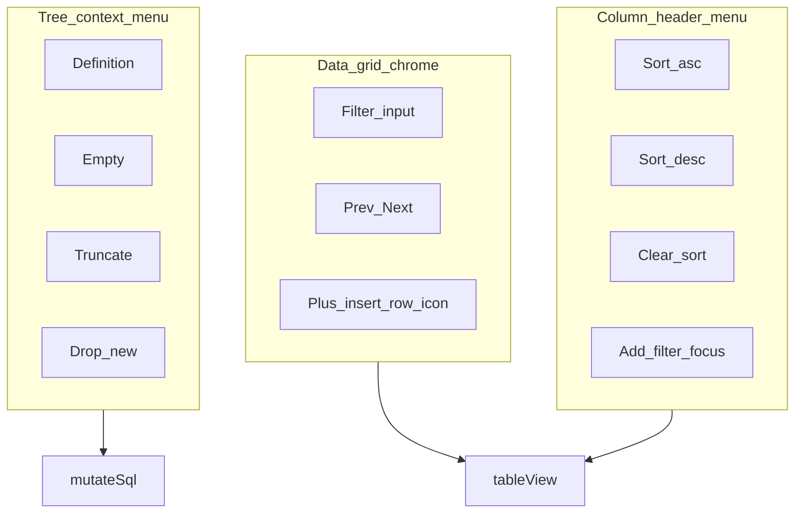

# Navicat 数据网格工具条与列头排序筛选

> 对照用户提供的 Navicat Premium 截图（列头排序菜单、筛选区）与当前 TW 表数据页工具条。  
> 不做：多条件筛选 Builder、Table Designer、对象列表「表」大工具条、右信息面板。

## 要保住的旧行为

- 打开数据库侧边栏不发起连接；只有点击连接才连
- 库顶栏页签、对象/SQL 平行子页签、Object Pane、左树层级仍可用
- 左树右键：打开 / 定义 / 重命名 / Empty / Truncate / 刷新 / 维护（能力保留）
- 表数据：分页、`LIMIT`/`OFFSET`、单元格单击编辑、置 NULL、删行、插入行、写审批
- CSV 导出/导入与「工具」菜单入口仍在
- `db-sort-*` / `db-grid-filter` / `db-row-insert` 行为可测；结构级操作改走右键后 e2e 改断言
- `node scripts/check-no-agent-hardcoding.mjs` 与 `./scripts/run-all-tests.sh` 通过

## 架构

- [`src/components/db/DbWorkbench.tsx`](../../src/components/db/DbWorkbench.tsx)：数据网格 `db-grid-nav` 去掉定义/删表/清空/截断；「新增」改为 `+` 图标按钮；列头挂菜单
- 新建或内联 [`src/components/db/ColumnHeaderMenu.tsx`](../../src/components/db/ColumnHeaderMenu.tsx)：升序 / 降序 / 清除排序 / 添加筛选（聚焦筛选框）
- [`src/components/db/workbenchModel.ts`](../../src/components/db/workbenchModel.ts)：`ObjectMenuAction` 增加 `drop`；`objectMenuActions` 对 table 追加；`handleObjectMenuAction` 走现有 `dropTableSql`
- [`src/components/db/ObjectContextMenu.tsx`](../../src/components/db/ObjectContextMenu.tsx) + i18n：`dbMenuDrop`
- e2e [`e2e/db-workbench.spec.ts`](../../e2e/db-workbench.spec.ts)：网格无结构按钮；列头菜单排序；右键含 drop
- [`docs/TEST_MATRIX.md`](../TEST_MATRIX.md) 数据库行补一句

依赖：现有 `sortBy` / `applyTableFilter` / `tableView`；本版 **不** 改 `filterWhere` 为多条件 Builder。

## 设计（界面路径）

1. **打开表数据页**  
   工具条只剩：筛选输入、上一页/下一页、`+`（新增行，仅 `table`）。  
   **不再出现**：定义、删表、清空表、截断。

2. **列头（对齐图 1）**  
   表对象页签下，列名旁可打开菜单：  
   - 升序排序 → `sortColumn` + `asc`  
   - 降序排序 → `desc`  
   - 移除所有排序 → `sortColumn = null` 并重载  
   - 添加筛选 → 聚焦 `db-grid-filter`（可把 placeholder 设为当前列名提示）  
   点列名本身仍可保留单击切换升降序（或改为只开菜单；实现时：**菜单三项管排序，单击列名仍 `sortBy` 切换**，避免破坏旧 e2e 的 `db-sort-id` click）。

3. **结构操作（对齐 Navicat，不对齐图 3 位置）**  
   仅左树对象右键：定义 / Empty / Truncate / **删表（新增）** / 重命名 / …  
   数据页工具条不再重复。

4. **明确不做（本计划）**  
   - 图 2 完整「多条件筛选 + 排序准则 + 应用筛选 & 排序」面板  
   - 网格顶栏大图标条（Refresh/Commit 全套）  
   - Table Designer 窗

## 任务（每项先红测再实现）

1. **网格去结构按钮**：e2e 开表后 `db-definition` / `db-drop-table` / `db-empty-table` / `db-truncate-table` 为 0；`db-row-insert` 仍在且为图标（aria-label 含新增/Insert）
2. **右键补删表**：单测 `objectMenuActions` 含 `drop`；e2e 右键可见 `db-object-menu-drop`；点后审批卡含 `DROP TABLE`
3. **列头菜单**：e2e 打开 `db-column-menu-id`（或等价），选降序后 SQL 含 `ORDER BY`/`DESC`；清除排序后无该列排序；添加筛选后 `db-grid-filter` 聚焦
4. **全量**：更新 TEST_MATRIX；`./scripts/run-all-tests.sh`
